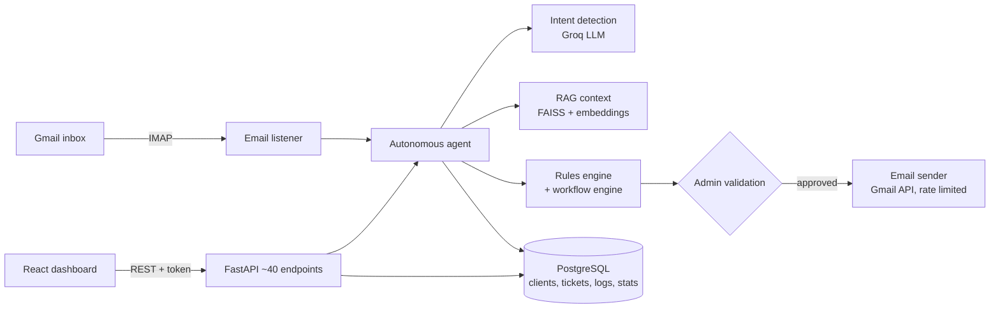

# AI Multi-Agent Platform: intelligent email automation


An autonomous AI platform that reads a company's incoming emails, understands what each
customer needs, finds similar past cases with RAG, and drafts or sends the right response,
while an operator monitors and validates everything from a web dashboard.

> Designed and built by **[Houda Mardas](#author)** as her engineering graduation project
> (PFE, Feb–Aug 2026) at Alexsys Solutions, Casablanca.

## What it does

- **Reads real emails** over IMAP (Gmail) and sends replies through the Gmail API (OAuth2),
  with rate limiting (20 emails/hour, 95/day) and retries.
- **Understands intent with an LLM** (Groq, Llama 3.3 70B): invoice, contract, support or
  general request, with a confidence score and an AI summary.
- **Retrieves context with RAG**: sentence-transformers embeddings and FAISS indexes built
  from public datasets (Enron emails, CUAD contracts, customer-support tickets, MultiWOZ dialogues).
- **Acts like a CRM agent**: creates support tickets, tracks invoices and contracts, detects
  duplicates, escalates urgent cases, and queues professional replies for human validation.
- **Business rules engine** running on a scheduler (APScheduler) with per-client cooldowns.
- **Visual workflow editor**: triggers, conditions, AI agents, RAG search, admin validation
  and email nodes, wired together with React Flow and executed by the backend workflow engine.
- **Document analysis**: upload PDFs for AI analysis, one by one or in batch.
- **Dashboard**: live KPIs, weekly trends, agent performance, logs, clients, pending and sent
  emails, and an AI chatbot over the indexed knowledge.

## Architecture



## Tech stack

| Area | Tools |
|---|---|
| AI | Groq API (Llama 3.3 70B), sentence-transformers (all-MiniLM-L6-v2), FAISS, RAG |
| Backend | Python, FastAPI, Pydantic, APScheduler, IMAP / SMTP, Gmail API (OAuth2) |
| Data | PostgreSQL (psycopg2 connection pool), pandas |
| Frontend | React 18, Vite, Recharts, React Flow, lucide-react, react-dropzone |

## Repository layout

| Path | Content |
|---|---|
| `backend/main.py` | FastAPI app: auth, dashboard, clients, emails, workflows, uploads, chatbot |
| `backend/autonomous_agent.py` | Autonomous agent, workflow engine, rules engine, email listener and sender |
| `backend/technologies/` | LLM client (Groq) and FAISS RAG engine |
| `backend/database/rag_manager.py` | Multi-collection RAG manager and dataset loaders |
| `backend/gmail_oauth.py` | Gmail API OAuth2 client |
| `frontend/src/Dashboard.jsx` | Full web dashboard and workflow editor |

## Getting started

Prerequisites: Python 3.11, Node.js 20, PostgreSQL, a Groq API key, and a Gmail account
with an app password and OAuth credentials (`credentials.json` from Google Cloud).

```bash
# Backend
cd backend
python -m venv .venv && source .venv/bin/activate   # Windows: .venv\Scripts\activate
pip install -r requirements.txt
cp .env.example .env        # fill in the keys, database and login passwords
python main.py              # API on http://localhost:8000, docs on /docs

# Frontend
cd ../frontend
npm install
cp .env.example .env        # VITE_API_URL=http://localhost:8000/api
npm run dev                 # http://localhost:5173
```

Datasets are not versioned: download Enron, CUAD, Customer Support Tickets and MultiWOZ and
point the `*_DATASET_PATH` variables to them. The FAISS indexes are built on first start.

## Security

- No secret is stored in the repository: API keys, Gmail credentials, database and login
  passwords are read from `.env`, which is git-ignored along with `token.pickle` and
  `credentials.json`.
- Login accounts stay disabled until their password is set in the environment.
- Outgoing emails are rate limited and can require admin validation before sending.

## Author

**Houda Mardas** · AI Engineer (generative AI, RAG, AI agents) · State Engineer in Computer
Engineering & AI (HESTIM, Casablanca)

- GitHub: [@houdamardas1](https://github.com/houdamardas1)
- LinkedIn: [houda-m-567987243](https://www.linkedin.com/in/houda-m-567987243)
- Portfolio: [portfoliohouda-mardas.netlify.app](https://portfoliohouda-mardas.netlify.app)
