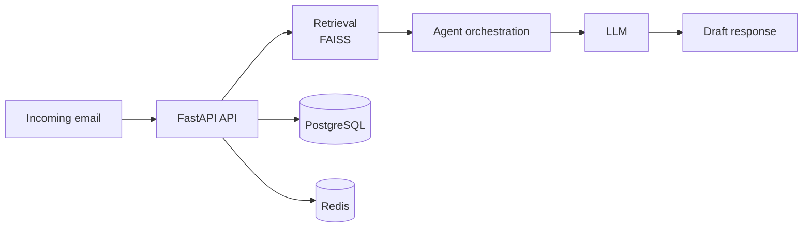

# AI Multi-Agent Platform

Multi-agent platform that automates email workflows using RAG and LLMs.
Graduation project (PFE, Feb–Aug 2026) at Alexsys Solutions.

## What it does

- Receives an email and retrieves relevant context with semantic search (FAISS)
- Orchestrates several agents to analyze, decide and draft a response with an LLM
- Exposes everything through an asynchronous FastAPI backend

## Tech stack

Python · FastAPI · LangChain · FAISS · PostgreSQL · Redis · Docker

## Architecture

## Status

The source code is not public because it was developed in a professional setting.
A walkthrough of the architecture can be shared on request.
