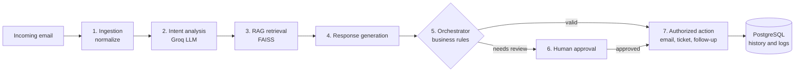

# AI Agents Platform: intelligent business process automation


AI Agents Platform automates business processes with specialized AI agents, a Large Language
Model (LLM), Retrieval-Augmented Generation (RAG) and workflow orchestration. It reads incoming
emails, understands what each customer needs, retrieves relevant knowledge, drafts a response
and executes authorized business actions, with human approval wherever an action needs review.

Unlike a classic chatbot that only answers questions, the platform lets agents take part in
real tasks under business rules and control mechanisms:

- **Understand**: analyze natural language requests, emails and documents.
- **Decide and orchestrate**: pick the right action and route the request to the right component.
- **Act and trace**: prepare or execute authorized actions, keep their history, and ask for human validation when needed.

> Designed and built by **[Houda Mardas](#author)** as her engineering final-year project
> (PFE, Feb–Aug 2026) at Alexsys Solutions, Casablanca.

## Key features

- **Multi-agent processing**: ingestion, intent analysis, document retrieval, response generation, orchestration and business actions.
- **LLM integration**: intent detection (support, invoice, contract, termination, complaint…), sentiment and urgency scoring, summaries and response drafting with Llama 3.3 70B through the Groq API.
- **RAG pipeline**: sentence-transformers embeddings and FAISS indexes over public datasets (Enron emails, CUAD contracts, customer-support tickets, MultiWOZ dialogues) to ground responses in relevant knowledge.
- **Real email processing**: IMAP listener for incoming mail, sending through the Gmail API (OAuth2) with rate limiting (20/hour, 95/day) and retries.
- **Workflow orchestration**: business rules engine on a scheduler, conditional routing, per-client cooldowns, duplicate detection and escalation of urgent cases; a visual workflow editor (React Flow) whose graphs are executed by the backend workflow engine.
- **Human-in-the-loop**: AI-drafted emails wait in an approval queue where an operator reviews them, can edit them, and approves the send.
- **Traceability**: every request, decision, email event and log is stored in PostgreSQL and shown in the dashboard.
- **Document analysis**: PDF upload for AI analysis, one by one or in batch.
- **Dashboard**: KPIs, weekly trends, agent performance, clients, pending and sent emails, logs and an AI assistant.

## How a request is processed



1. Receive and normalize the email or business request.
2. Detect the intent and extract the relevant information.
3. Retrieve context through the RAG pipeline when needed.
4. Generate a response with the LLM.
5. Apply business rules and validation checks.
6. Request human approval when necessary.
7. Execute the authorized action and record the outcome.

## Use cases

- Customer support request processing and ticket creation
- Invoice-related email analysis and follow-ups
- Contract and administrative document assistance
- Automated response drafting
- Business workflow execution
- Processing history and operational monitoring

## Technology stack

| Area | Tools |
|---|---|
| AI | Llama 3.3 70B (Groq API), sentence-transformers (all-MiniLM-L6-v2), FAISS, RAG |
| Backend | Python, FastAPI (Swagger UI), Pydantic, APScheduler |
| Email | IMAP, Gmail API with OAuth2 |
| Data | PostgreSQL (`agents_ia_db`, psycopg2 connection pool), pandas |
| Frontend | React 18, Vite, Recharts, React Flow, lucide-react, react-dropzone |

The internship report also describes Redis, Docker Compose and Prometheus/Grafana as part of
the target architecture. They are not included in this public version of the code.

## Repository layout

| Path | Content |
|---|---|
| `backend/main.py` | FastAPI app (~40 endpoints): auth, dashboard, clients, emails, workflows, uploads, assistant |
| `backend/autonomous_agent.py` | Autonomous agent, workflow engine, rules engine, email listener and sender |
| `backend/technologies/` | LLM client (Groq) and FAISS RAG engine |
| `backend/database/rag_manager.py` | Multi-collection RAG manager and dataset loaders |
| `backend/gmail_oauth.py` | Gmail API OAuth2 client |
| `frontend/src/Dashboard.jsx` | Web dashboard and visual workflow editor |
| `docs/architecture.md` | Detailed architecture: agents, RAG pipeline, orchestration, human-in-the-loop |

## Getting started

Prerequisites: Python 3.11, Node.js 20, PostgreSQL, a Groq API key, and a Gmail account with an
app password and OAuth credentials (`credentials.json` from Google Cloud).

```bash
# Backend
cd backend
python -m venv .venv && source .venv/bin/activate   # Windows: .venv\Scripts\activate
pip install -r requirements.txt
cp .env.example .env        # fill in the keys, database and login passwords
python main.py              # API on http://localhost:8000, Swagger UI on /docs

# Frontend
cd ../frontend
npm install
cp .env.example .env        # VITE_API_URL=http://localhost:8000/api
npm run dev                 # http://localhost:5173
```

Datasets are not versioned: download Enron, CUAD, Customer Support Tickets and MultiWOZ and point
the `*_DATASET_PATH` variables to them. The FAISS indexes are built on first start.

## Security

- No API key, password, OAuth token or customer data is committed: configuration comes from
  `.env` (see `.env.example`), and `token.pickle`, `credentials.json`, local databases and
  indexes are git-ignored.
- Dashboard accounts stay disabled until their password is set in the environment.
- Outgoing emails are rate limited and can require human approval before sending.
- Human approval reduces risk but is not a guarantee: AI-drafted content should still be reviewed.

## Author

**Houda Mardas** · AI Engineer (generative AI, RAG, AI agents) · State Engineer in Computer
Engineering & AI (HESTIM, Casablanca)

- GitHub: [@houdamardas1](https://github.com/houdamardas1)
- LinkedIn: [houda-m-567987243](https://www.linkedin.com/in/houda-m-567987243)
- Portfolio: [portfoliohouda-mardas.netlify.app](https://portfoliohouda-mardas.netlify.app)
