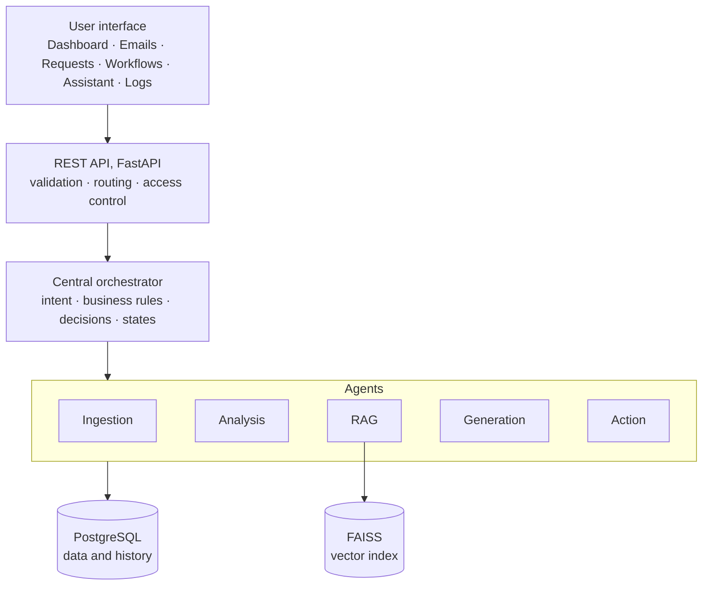

# Architecture

This document describes the design of AI Agents Platform as presented in the internship report,
and maps each part to the code in this repository.

## Business problem

Many business processes remain partly manual: reading and sorting emails, analyzing customer
requests, searching documents, drafting replies, following up on communications and producing
reports. This costs time, delays responses, scatters information across tools, makes past
decisions hard to trace and leaves little visibility on process performance.

**Central question:** how can a platform of AI agents understand business requests, use a
knowledge base, orchestrate actions and keep track of them in a structured and controlled way?

## Layers

| Layer | Role | Code |
|---|---|---|
| Presentation | Admin dashboard, analytics, requests, emails to send, sent emails, workflows, AI upload, logs, assistant | `frontend/src/Dashboard.jsx` |
| API | Receives and validates requests, exposes REST endpoints, Swagger UI | `backend/main.py` |
| AI | Agents, LLM, RAG pipeline and business rules, coordinated by the orchestrator | `backend/autonomous_agent.py`, `backend/technologies/` |
| Data | Structured persistence and vector search | PostgreSQL, `backend/database/rag_manager.py` |

## Agents

| Agent | Responsibility | Implementation |
|---|---|---|
| Ingestion | Receives emails and requests, extracts subject, body and sender | `RealEmailListener` (IMAP), `GmailOAuth.get_unread_messages` |
| Analysis | Detects intent, sentiment, urgency and business category | `LLMEngine.comprendre_intention` |
| RAG | Retrieves relevant passages from the knowledge base | `RAGManager`, `RealRAGEngine` |
| Generation | Writes summaries, responses and suggested actions | `LLMEngine.generer_reponse_personnalisee`, `IntelligentAutonomousAgent` |
| Orchestration | Combines analysis, context, confidence and rules to decide the next step | `IntelligentAutonomousAgent.traiter_email_intelligent`, `RuleEngine`, `WorkflowEngine` |
| Action | Sends or queues emails, creates tickets, triggers follow-ups | `RealEmailSender`, `RuleEngine` |

## RAG pipeline

**Preparation:** load documents, extract and clean text, compute embeddings with
`all-MiniLM-L6-v2` (384 dimensions), index them in FAISS, and keep document metadata so each
passage can be traced back to its source.

**Query time:** embed the question, search the nearest passages in FAISS, inject them into the
prompt, generate the answer with the LLM, then structure the output for the next step.

Grounding answers in retrieved documents reduces unsupported answers and improves
traceability, but does not remove the risk of hallucination entirely: retrieval quality and
output checks still matter.

## Workflow orchestration

The orchestrator combines LLM results with deterministic business rules. A workflow can skip
retrieval when it is not needed, retry a weak step, ask for human review, pause on uncertainty,
and always records the decision and the outcome. Workflows can also be designed visually in the
dashboard (trigger, condition, support agent, invoice agent, RAG search, admin validation, email,
ticket nodes) and executed by `WorkflowEngine`.

## Human-in-the-loop

1. The agent analyzes the request.
2. The LLM drafts a response or an action.
3. The orchestrator applies validation rules.
4. If approval is required, the proposal waits in the queue (`/api/emails/pending`).
5. An authorized user reviews it in the dashboard.
6. It is approved, optionally after editing, and sent (`/api/emails/validate/{id}`).
7. The result is logged for traceability.

## Data

The report describes a PostgreSQL database, `agents_ia_db`, with 18 operational tables covering
users, emails, requests and orchestrator decisions, email events, logs, workflows and
statistics. FAISS plays a different role: it serves vector search over documents and does not
replace the relational database.

## Reliability

Error handling covers unavailable external services, failed API calls, missing retrieval
results, inconsistent LLM output, timeouts and ambiguous multi-intent requests, through retries,
logging, fallback responses and escalation to a human.

## Target architecture not included here

The report also plans Redis (cache and asynchronous processing), Docker Compose (multi-service
deployment) and Prometheus/Grafana (metrics). These parts are not part of this public version.
